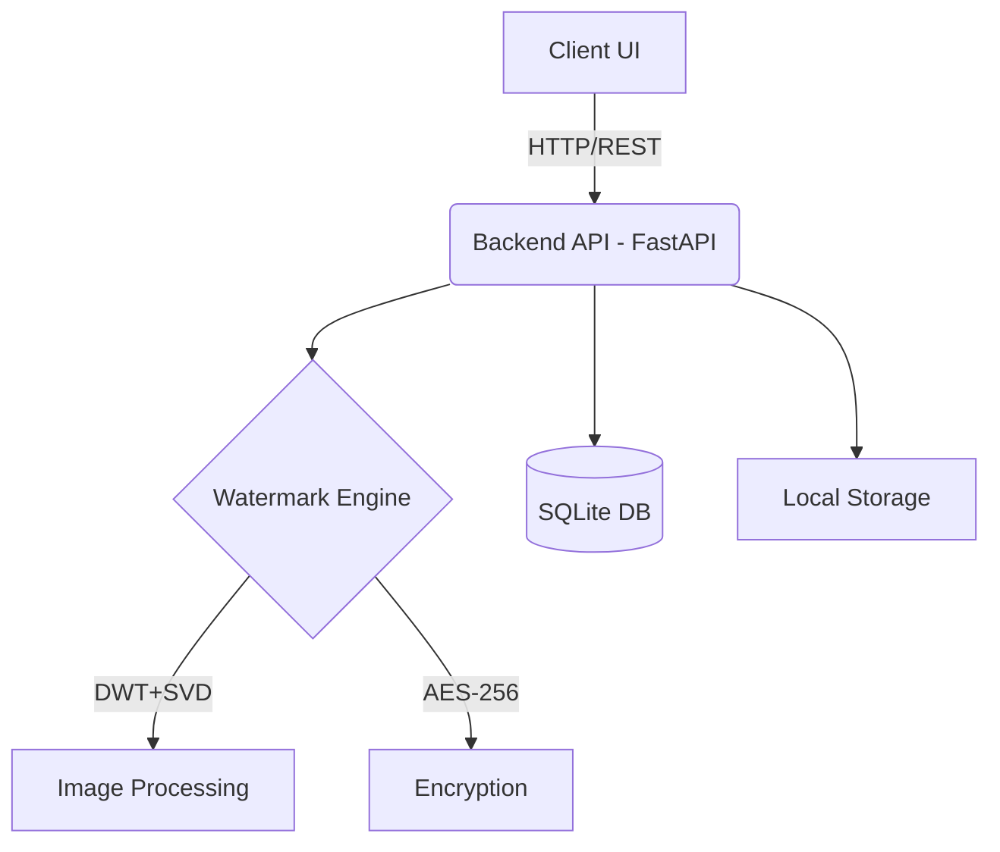

# ProvenAI


A robust digital watermarking and provenance tracking system designed to secure intellectual property in the age of generative AI.

## Table of Contents
- [Features](#features)
- [Architecture](#architecture)
- [Tech Stack](#tech-stack)
- [Quick Start](#quick-start)
- [Project Structure](#project-structure)
- [API Documentation](#api-documentation)
- [Watermarking Algorithm](#watermarking-algorithm)
- [Screenshots](#screenshots)
- [Environment Variables](#environment-variables)
- [Usage Guide](#usage-guide)
- [Security Features](#security-features)
- [Performance Metrics](#performance-metrics)
- [Future Scope](#future-scope)
- [Contributing](#contributing)
- [License](#license)
- [Authors](#authors)

## Features
- **Invisible Watermarking**: DWT-SVD based algorithm for imperceptible watermarking.
- **Robust Extraction**: High resilience against common attacks (compression, noise, cropping).
- **AES-256 Encryption**: Payload encryption for security.
- **RESTful API**: Fast and fully documented backend API.
- **Modern UI**: React-based frontend for intuitive user interaction.
- **Authentication**: JWT-based secure user sessions.
- **Provenance Tracking**: Maintains a history of verified digital assets.

## Architecture


## Tech Stack
| Component | Technology |
|---|---|
| Frontend | React, Vite, Tailwind CSS |
| Backend | Python, FastAPI, SQLAlchemy |
| Processing | OpenCV, NumPy, PyWavelets |
| Database | SQLite |
| Infrastructure | Docker, Docker Compose, Nginx |

## Quick Start

### Using Docker (Recommended)
1. Clone the repository: `git clone https://github.com/yourusername/provenai.git`
2. Navigate to directory: `cd provenai`
3. Copy `.env.example` to `.env` and configure variables.
4. Run: `docker-compose up -d --build`
5. Access UI at `http://localhost` and API docs at `http://localhost:8000/docs`.

### Manual Setup
Refer to the individual `README.md` files in the `frontend` and `backend` directories.

## Project Structure
```
ProvenAI/
├── backend/          # FastAPI backend application
├── frontend/         # React frontend application
├── docs/             # Documentation and reports
├── storage/          # Local volume for assets (gitignored)
├── .env              # Environment configurations
├── docker-compose.yml
└── README.md
```

## API Documentation
| Endpoint | Method | Description |
|---|---|---|
| `/api/health` | GET | Check system health |
| `/api/auth/login` | POST | Authenticate user |
| `/api/watermark/embed`| POST | Embed watermark into image |
| `/api/watermark/extract`| POST | Extract watermark from image |
| `/api/assets` | GET | List user's protected assets |

## Watermarking Algorithm
The system utilizes a hybrid Discrete Wavelet Transform (DWT) and Singular Value Decomposition (SVD) approach.
1. The host image is decomposed into 4 sub-bands (LL, HL, LH, HH) using DWT.
2. SVD is applied to the selected sub-band (e.g., HL).
3. The singular values are modified with the encrypted watermark payload.
4. Inverse SVD and Inverse DWT are applied to reconstruct the watermarked image.

## Screenshots
*(Screenshots of the application UI will be placed here)*

## Environment Variables
| Variable | Description |
|---|---|
| `PROJECT_NAME` | Name of the project |
| `SECRET_KEY` | JWT signing key |
| `DATABASE_URL` | Database connection string |
| `AES_KEY_HEX` | 256-bit AES key in hex format |

## Usage Guide
1. **Login/Register**: Access the system with secure credentials.
2. **Upload**: Select an image to protect.
3. **Embed**: Provide text or logo to embed as a watermark. The system returns the secured image.
4. **Verify**: Upload any image to check for existing ProvenAI watermarks.

## Security Features
- Watermark payloads are AES-256 encrypted before embedding.
- Arnold Cat Map scrambling adds spatial security to the watermark.
- Role-based access control via JWT.

## Performance Metrics
- High Peak Signal-to-Noise Ratio (PSNR > 40dB) ensures visual quality.
- High Structural Similarity Index (SSIM > 0.98).
- Low Bit Error Rate (BER) during extraction.

## Future Scope
- Video watermarking support.
- Blockchain integration for immutable provenance records.
- Support for distributed cloud storage (AWS S3).

## Contributing
Please read `CONTRIBUTING.md` for details on our code of conduct, and the process for submitting pull requests.

## License
This project is licensed under the MIT License - see the LICENSE file for details.

## Authors
- ProvenAI Development Team
